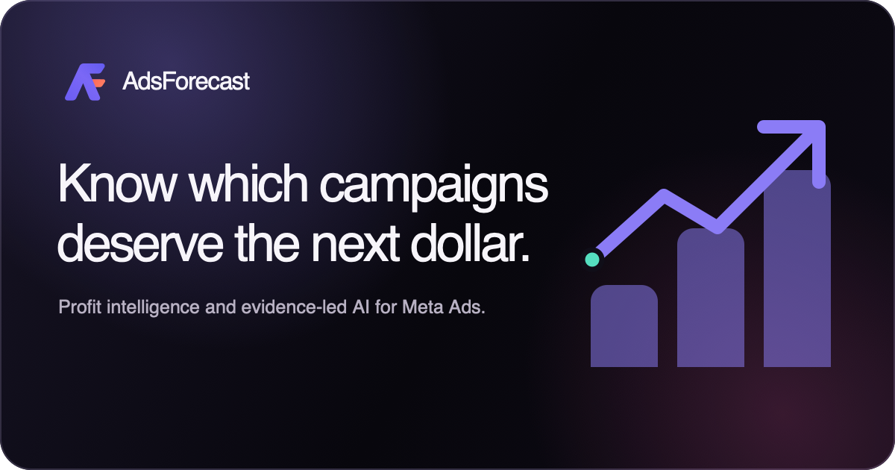
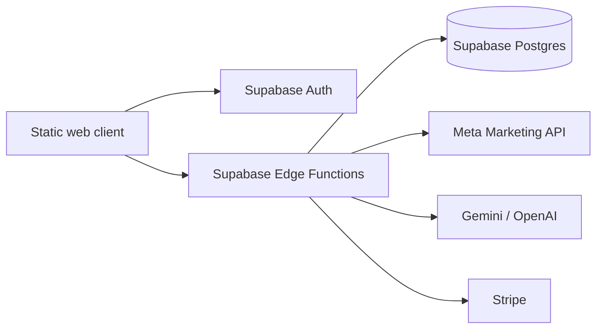

<p align="center">
  
</p>

<p align="center">
  Profit intelligence and evidence-led AI for Meta Ads.
</p>

<p align="center">
  <a href="https://github.com/the0kan/adsforecast/actions/workflows/ci.yml"></a>
  <a href="LICENSE"></a>
  <a href="https://adsforecast.com"></a>
  
</p>

<p align="center">
  <a href="https://adsforecast.com">Live product</a> ·
  <a href="docs/launch-checklist.md">Launch checklist</a> ·
  <a href="CONTRIBUTING.md">Contributing</a> ·
  <a href="SECURITY.md">Security</a>
</p>



AdsForecast is a profit-first operating workspace for Meta Ads. It combines campaign evidence, contribution-margin modelling, AI-assisted decisions, workspace operations, billing readiness and customer support in one tenant-aware product.

> [!IMPORTANT]
> The product is ready for private-beta operation. Public paid launch remains gated until Stripe price mappings, signed webhooks and the Customer Portal have been verified in both test and live modes.

## What it does

- Turns campaign metrics into contribution-margin and break-even decisions.
- Organizes daily, weekly, monthly, 90-day and custom reporting views.
- Provides a five-layer AI analyst with deterministic fallback behaviour.
- Keeps Meta OAuth tokens encrypted and outside browser storage.
- Separates customer workspaces from platform administration.
- Supports an explicitly labelled, network-isolated demo workspace via `?demo=1`.

## Architecture



| Layer | Responsibility |
| --- | --- |
| Web client | Responsive HTML, CSS and ES modules hosted as a static site |
| Identity | Supabase Auth and explicit bearer sessions |
| Application boundary | Bounded Supabase Edge Functions with per-request authorization |
| Source of truth | Supabase Postgres with workspace tenancy and row-level security |
| Integrations | Meta OAuth, AI providers and Stripe; provider secrets remain server-side |
| Operations | Support tickets, platform roles, readiness checks and audit logs |

The browser receives only publishable Supabase configuration. Service-role credentials, provider keys, OAuth tokens and webhook secrets belong exclusively in Edge Function secrets.

## Quick start

### Prerequisites

- Node.js 20 or newer
- Python 3.11 or newer for the local server and browser quality suite

```bash
git clone https://github.com/the0kan/adsforecast.git
cd adsforecast
npm ci
npm run dev
```

Open `http://localhost:5173/index.html`. To explore the sample workspace without contacting Supabase, open `http://localhost:5173/overview.html?demo=1`.

### Run the complete quality suite

```bash
python3 -m pip install -r requirements-dev.txt
python3 -m playwright install chromium
npm run verify
```

The suite checks JavaScript syntax, public marketing routes, authentication flows, product interactions, responsive layouts, accessibility basics and the platform control plane. CI runs the same command on every pull request and every push to `main`.

## Product routes

| Area | Routes |
| --- | --- |
| Marketing | `index.html`, `product.html`, `how-it-works.html`, `pricing.html`, `faq.html` |
| Identity | `login.html`, `signup.html` |
| Product | `overview.html`, `campaigns.html`, `profitability.html`, `insights.html` |
| Workspace | `integrations.html`, `profile.html`, `settings.html`, `billing.html`, `support.html` |
| Platform operations | `control-center.html` |

## Supabase workflow

Link the intended project before applying or deploying anything:

```bash
npx supabase link --project-ref YOUR_PROJECT_REF
npx supabase db push --linked --dry-run
npx supabase db push --linked
npm run backend:deploy
```

Required server secrets depend on the enabled providers:

- Core: `SUPABASE_URL`, `SUPABASE_SERVICE_ROLE_KEY`, `TOKEN_ENCRYPTION_SECRET`, `FRONTEND_URL`
- Meta: `META_APP_ID`, `META_APP_SECRET`, `META_REDIRECT_URI`, `META_API_VERSION`, `META_SCOPES`, `OAUTH_STATE_SECRET`
- AI: `GEMINI_API_KEY` and optional `GEMINI_MODEL`, or `OPENAI_API_KEY` and optional `OPENAI_MODEL`
- Stripe: `STRIPE_SECRET_KEY`, `STRIPE_WEBHOOK_SECRET`, `STRIPE_MODE`, plus product and price IDs configured in the admin plan editor

Never commit provider secrets, service-role keys, Meta tokens or Stripe credentials. See [Security](SECURITY.md) and the [Stripe activation runbook](docs/stripe-activation-runbook.md) before enabling paid access.

For database or Edge Function changes, also verify the linked backend:

```bash
npx supabase db lint --linked --level error
npx supabase migration list --linked
npx supabase functions list
```

## Repository map

```text
assets/                 Brand and social assets
docs/                   Operations, launch and architecture documentation
scripts/                Browser audits and repository verification
specs/                  Product and launch-readiness specifications
supabase/functions/     Edge Functions and shared server modules
supabase/migrations/    Versioned database changes and RLS policies
tests/                  End-to-end product checks
*.html, *.css, *.js     Static application and marketing experience
```

## Documentation

- [Launch checklist](docs/launch-checklist.md)
- [Stripe activation runbook](docs/stripe-activation-runbook.md)
- [Admin operations](docs/admin-operations.md)
- [Architecture decision record](docs/adr/0001_launch_architecture.md)
- [Reverse-engineered product specification](specs/adsforecast_reverse_spec.md)
- [Launch-readiness design](specs/launch_readiness_design.md)
- [Brand system](BRAND.md)
- [Changelog](CHANGELOG.md)

## Contributing and license

Small, focused changes are welcome. Read [CONTRIBUTING.md](CONTRIBUTING.md), keep trust boundaries intact and run `npm run verify` before opening a pull request.

AdsForecast is available under the [MIT License](LICENSE).
